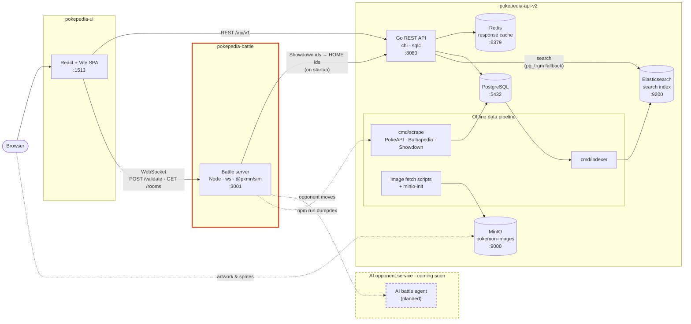
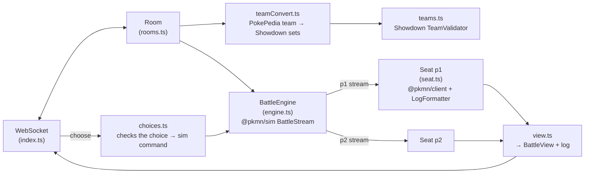
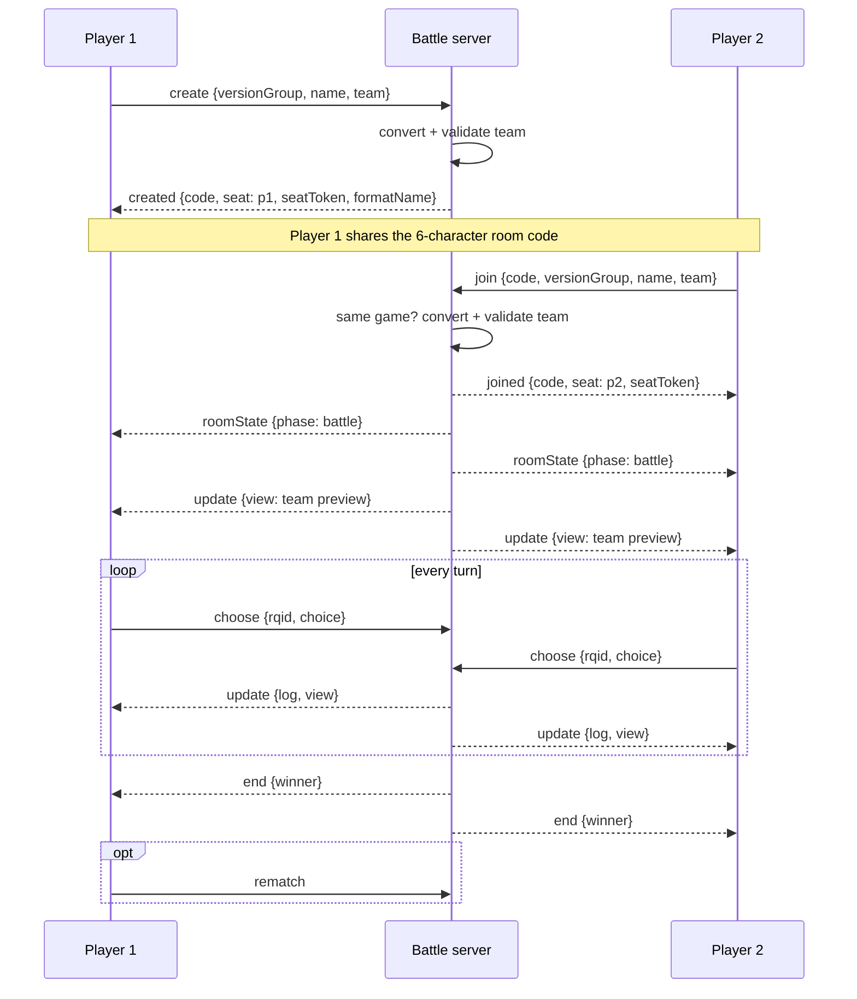

# PokePedia (Battle Service)
The WebSocket battle server behind the battle simulator in the [PokePedia Web Version](https://github.com/Rishi2804/pokepedia-ui).
It runs real Pokémon Showdown battles server-side: it turns PokePedia teams into Showdown sets, validates them against the
rules of the game they were built for, runs the battle, and sends each player their own ready-to-render view of it. The browser
never needs a Pokédex or has to read Showdown's raw battle protocol.

<picture>
  <source media="(prefers-color-scheme: dark)" srcset="https://github.com/user-attachments/assets/0dd93dcc-231f-4f51-b2b3-b334891bb922">
  
</picture>

## Technologies 💻
- Node.js 20 + TypeScript
- [ws](https://github.com/websockets/ws) (WebSocket server, sharing a port with a small HTTP API)
- [@pkmn](https://github.com/pkmn/ps) packages, built on Pokémon Showdown:
  - `@pkmn/sim` (battle engine and team validator)
  - `@pkmn/client` + `@pkmn/view` (tracking each player's battle state and formatting the battle log)
  - `@pkmn/data` (Pokédex data) and `@pkmn/img` (sprite URLs)
- Docker
- Uses the [PokePedia API](https://github.com/Rishi2804/pokepedia-api-v2) for sprite ids and its image store for sprites

## System Design 🏗️
PokePedia is split into three services. This repo is the battle server (highlighted).



> 🤖 **Coming soon:** an AI opponent, planned as its own service, so players can battle without a second person.

### Inside the battle server
Each room runs one Showdown battle stream. It is split into a private stream per player, so each player only ever
sees their own team's details and decision requests, and never the opponent's.



## Battle Flow ⚔️


**Disconnects:** if a player's socket closes mid-battle, a 60 second timer starts. Sending `resume {code, seatToken}` (the UI does this when the battle page reloads)
re-attaches the player and replays the current view and full battle log. If the timer runs out, the opponent wins by forfeit.

**Cleanup:** every 60 seconds the server deletes rooms that have been idle for 15 minutes, or finished for 2 minutes.

## WebSocket Protocol 📡
Connect to `ws://<host>:3001`. Messages are JSON objects with a `t` field for the type.
The full types live in [`src/protocol.ts`](src/protocol.ts), which the UI mirrors.

**Client → server**

| Message | Fields | Description |
|---|---|---|
| `create` | `versionGroup`, `name`, `team` | Create a room and take seat `p1`. `versionGroup: null` means a HOME team |
| `join` | `code`, `versionGroup`, `name`, `team` | Join a room as `p2`. The version group must match the room's |
| `resume` | `code`, `seatToken` | Reconnect to your seat |
| `choose` | `rqid`, `choice` | Answer the current request (`rqid` must match) |
| `leave` | | Leave the room (starts the forfeit timer mid-battle) |
| `rematch` | | Start a new battle with the same players and teams once it has ended |

A `choice` is one of:
- `{kind: 'move', index, tera?, mega?, zmove?, dynamax?}`
- `{kind: 'switch', index}`
- `{kind: 'team', order}` (team preview lead order)
- `{kind: 'default'}`
- `{kind: 'undo'}`

**Server → client**

| Message | Fields | Description |
|---|---|---|
| `created` / `joined` | `code`, `seat`, `seatToken`, `format`, `formatName` | You're in the room. Keep `seatToken` to reconnect |
| `roomState` | `phase`, `players` | Room phase (`waiting`, `validating`, `battle`, `ended`) and who is connected |
| `update` | `log`, `view` | New battle log lines and your current `BattleView` |
| `end` | `winner`, `log`, `view` | Battle over (`winner` is a side, `tie` or `null`) |
| `error` | `code`, `message`, `problems?` | Something went wrong (see below) |
| `debug` | `lines` | Raw Showdown protocol lines, only when `BATTLE_DEBUG_PROTOCOL=1` |

A `BattleView` holds everything the UI draws: the turn, field (weather, terrain), your side and the foe's side
(active Pokémon with sprite, HP, status and boosts; the foe's team only shows Pokémon that have been revealed), and the current
`request`: which moves and switches are available, and whether Tera / Mega / Z-Move / Dynamax can be used.

**Error codes:** `invalid_message`, `room_not_found`, `room_full`, `invalid_seat_token`, `gen_mismatch`, `team_invalid`
(with `problems`), `not_your_turn`, `invalid_choice`, `rematch_unavailable`, `internal_error`.

## HTTP Endpoints 🌐
Served on the same port as the WebSocket.

| Method | Path | Description |
|---|---|---|
| `GET` | `/healthz` | Returns `ok` |
| `POST` | `/validate` | Body `{versionGroup, team}` → `{valid, problems[]}`. Converts the team and runs Showdown's validator without making a room. The team builder uses this for live validation |
| `GET` | `/rooms/:code` | Room lookup → `{code, versionGroup, formatName, host, joinable}`, or `404` |

CORS allows the origins in `BATTLE_ALLOWED_ORIGINS` (all origins if empty). WebSocket connections from other origins are rejected.

## Formats 🎮
Every battle is singles Anything Goes. The format always comes from the team's game (version group), never from the client.

| Version groups | Format |
|---|---|
| Red/Blue, Yellow | Gen 1 Anything Goes |
| Gold/Silver, Crystal | Gen 2 Anything Goes |
| Ruby/Sapphire, Emerald, FireRed/LeafGreen | Gen 3 Anything Goes |
| Diamond/Pearl, Platinum, HeartGold/SoulSilver | Gen 4 Anything Goes |
| Black/White, Black 2/White 2 | Gen 5 Anything Goes |
| X/Y, Omega Ruby/Alpha Sapphire | Gen 6 Anything Goes |
| Sun/Moon, Ultra Sun/Ultra Moon, Let's Go Pikachu/Eevee | Gen 7 Anything Goes |
| Sword/Shield, Brilliant Diamond/Shining Pearl, Legends: Arceus | Gen 8 Anything Goes |
| Scarlet/Violet | Gen 9 Anything Goes |
| Legends: Z-A | National Dex AG with Z-A Mega Stones, no Terastallization |
| HOME (no game) | National Dex Anything Goes (every Pokémon; Mega, Z-Moves and Tera all allowed) |

Gens 4 and 6–9 use Showdown's built-in formats. Gens 1, 2, 3 and 5 are built from Showdown's custom game with the same rules.
Each game's team-building rules (EV/IV model, natures, items, abilities, Tera, Dynamax...) live in [`src/versionRules.ts`](src/versionRules.ts)
and are exported to the UI with `npm run dumprules`.

## Getting Started 🚀
### Environment
Create a `.env` file in the project root (all optional):

| Variable | Description | Default |
|---|---|---|
| `PORT` | Server port | `3001` |
| `BATTLE_ALLOWED_ORIGINS` | Comma-separated list of allowed browser origins | all (Compose: `http://localhost:1513`) |
| `POKEPEDIA_API_URL` | Go API base URL, used on startup to map Showdown ids to HOME sprite ids | unset (sprites fall back to dex numbers) |
| `SHOWDOWN_SPRITES_DOMAIN` | Where the browser loads battle sprites from | Showdown's CDN (Compose: `localhost:9000/pokemon-images/showdown`) |
| `SHOWDOWN_SPRITES_PROTOCOL` | `http` or `https` for sprite URLs | `http` if a domain is set, else `https` |
| `BATTLE_DEBUG_PROTOCOL` | Set to `1` to also send raw protocol lines to clients | off |

### Run it
```bash
npm install
npm run dev          # watch mode on :3001
```

Or with Docker (expects the API on the host at `:8080`):
```bash
docker compose up -d
```

### Running the whole stack
Clone [pokepedia-api-v2](https://github.com/Rishi2804/pokepedia-api-v2) and [pokepedia-ui](https://github.com/Rishi2804/pokepedia-ui) next to this repo,
then start the API first, followed by this server and the UI (`docker compose up -d` in each).

## Scripts 🛠️
| Script | Description |
|---|---|
| `npm run dev` / `npm start` | Run with reload / run once |
| `npm run build` / `npm run typecheck` | Compile to `dist/` / type-check only |
| `npm run play` | Terminal client. Play a random bot in-process, or `--create` / `--join CODE` against a running server (`--gen N\|nationaldex`) |

**Checks** (each prints `ok` / `FAIL`):

| Script | What it checks |
|---|---|
| `npm run selfplay` | Plays random-vs-random battles in every format and checks each choice is accepted and neither player sees the other's hidden info (`--gen`, `--verbose`) |
| `npm run roomcheck` | `GET /rooms/:code` and version-group mismatch on join |
| `npm run validatecheck` | `POST /validate` with legal and illegal teams |
| `npm run homecheck` | HOME sprite id loading and lookup order (also checks the live API if `POKEPEDIA_API_URL` is set) |
| `npm run spritecheck` | Sprite URLs per generation, shiny/back variants and Dynamax/Gigantamax |
| `npx tsx scripts/convert-check.ts` | PokePedia → Showdown team conversion |

**Data exports:**

| Script | Description |
|---|---|
| `npm run dumpdex -- <out-dir>` | Writes Showdown's species, moves and abilities as JSON for the API's scraper (`cmd/scrape/data`) |
| `npm run dumprules -- <out.json>` | Writes each game's team-building rules as JSON for the UI (`src/global/data/battleRules.json`) |

## Project Structure 📁
```
src/
├── index.ts         # HTTP + WebSocket server, routing and message checks
├── protocol.ts      # Every client/server message and view type
├── rooms.ts         # Rooms: lifecycle, players, forfeit timer, rematch, cleanup
├── engine.ts        # Wraps the @pkmn/sim battle stream and splits it per player
├── seat.ts          # One per player: battle state, log formatting, reconnects
├── view.ts          # Battle state → BattleView, request fixes, log classification
├── choices.ts       # Checks a player's choice and turns it into a sim command
├── teamConvert.ts   # PokePedia team → Showdown sets (EVs/IVs, battle-only formes...)
├── teams.ts         # Team validation
├── formats.ts       # Showdown format strings and names
├── versionRules.ts  # Per-game team-building rules
├── sprites.ts       # Battle sprite URLs
└── homeIds.ts       # Showdown id → PokePedia HOME id, loaded from the API
scripts/             # Check scripts, data exports and the terminal client
```
